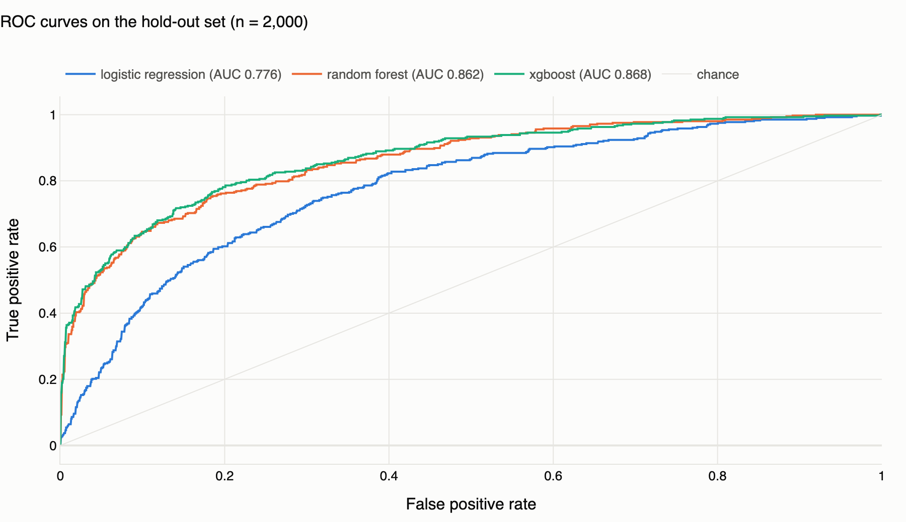
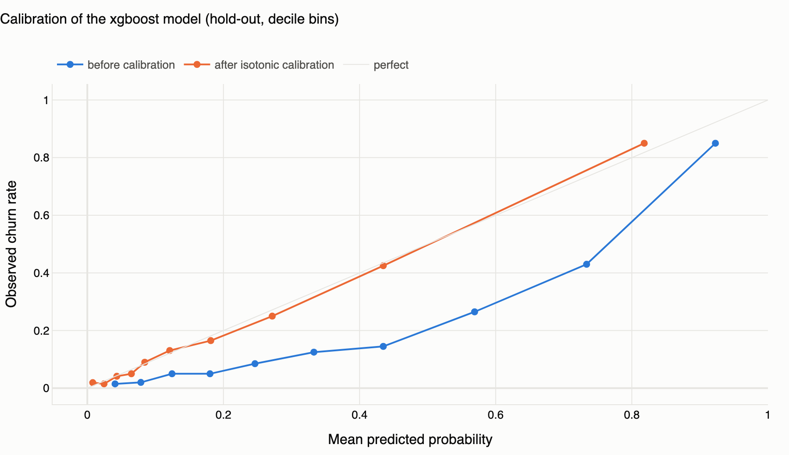
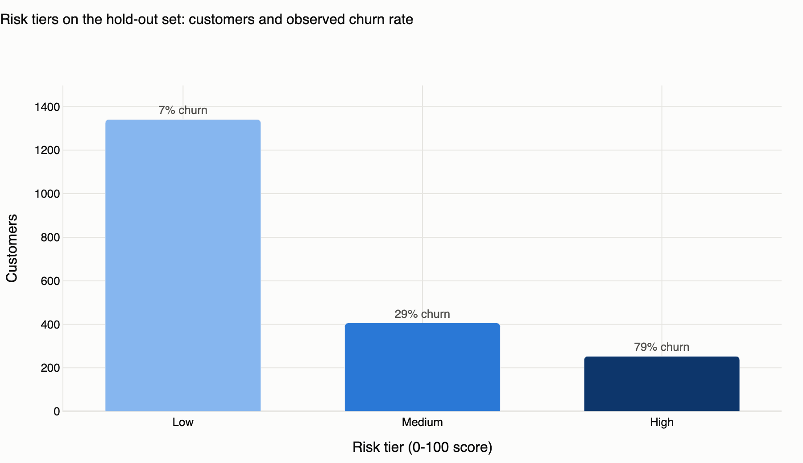
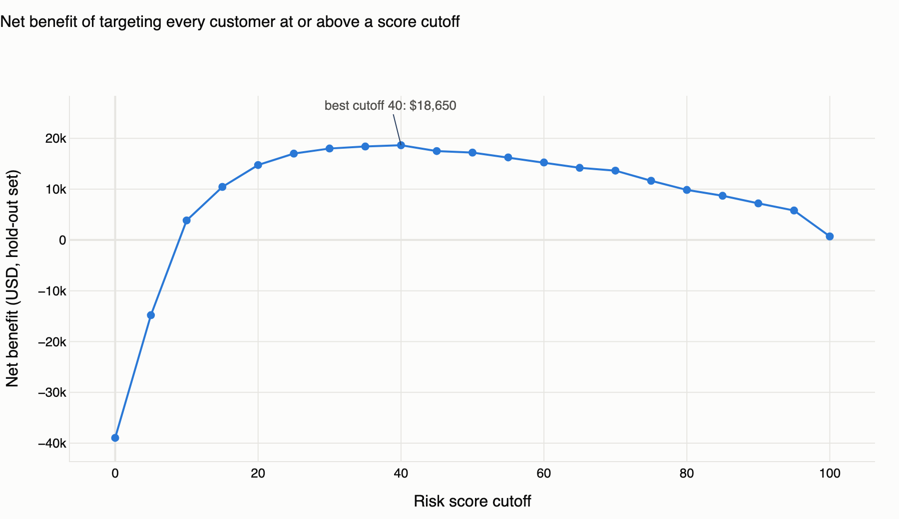
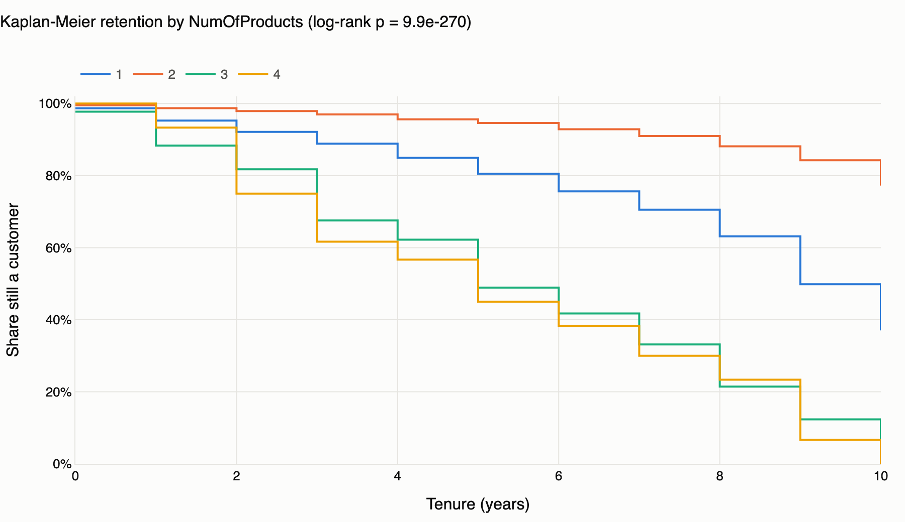
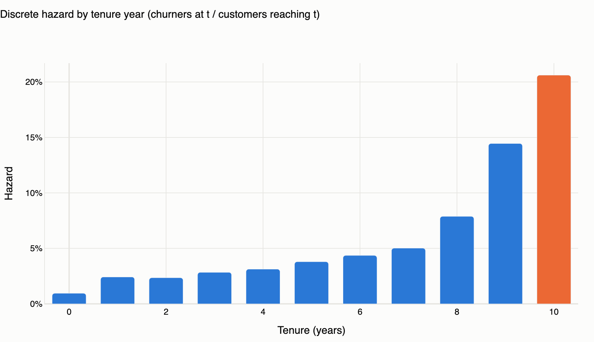
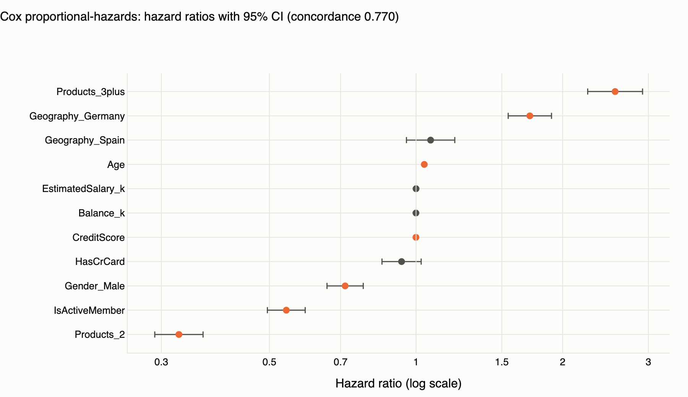
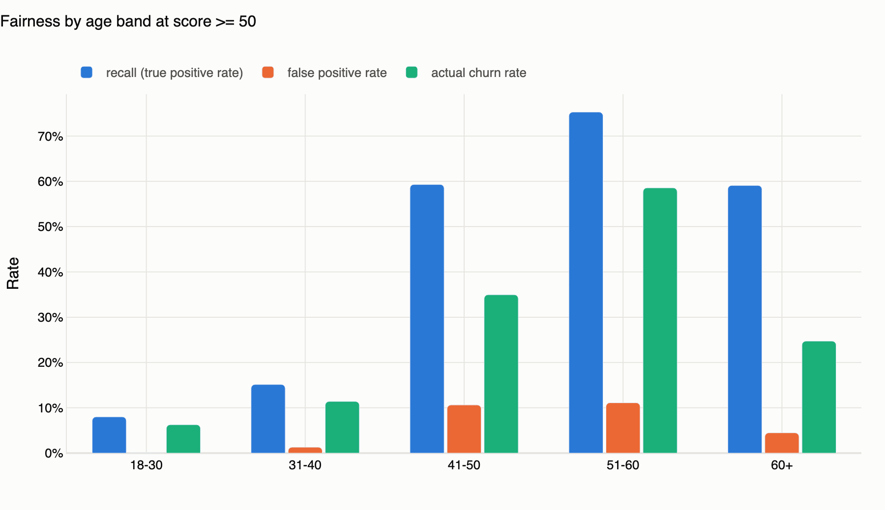

# Bank Customer Churn: risk scoring, survival analysis and fairness check

An end-to-end, reproducible churn-risk project on a public retail-bank dataset
(10,000 customers in France, Germany and Spain). It answers three questions a
retention team actually asks:

1. **Who is likely to leave?** Calibrated classification models turned into a
   0-100 risk score with Low / Medium / High tiers and a cost-benefit view.
2. **When does the risk peak?** Kaplan-Meier and Cox survival analysis on tenure.
3. **Is the score fair to use?** Recall and false-positive-rate checks by gender
   and age band.

Everything below is produced by one notebook
([`notebooks/bank_churn_analysis.ipynb`](notebooks/bank_churn_analysis.ipynb)),
backed by a small tested package in [`src/churn/`](src/churn/) and exported to a
static dashboard ([`reports/dashboard.html`](reports/dashboard.html)).

| | |
|---|---|
| Hold-out ROC AUC (XGBoost, calibrated) | **0.868** |
| Hold-out PR AUC (base rate 20.4%) | **0.720** |
| Brier score after isotonic calibration | **0.099** (0.136 before) |
| High-risk tier | **12.7% of customers hold 48.9% of churners**, 78.7% churn rate, 3.9x lift |
| Best retention cutoff (score >= 40) | net benefit **$18,650** per 2,000 customers under the stated assumptions |
| Churn hazard peak | **tenure years 9-10** (14.5% and 20.6% of customers reaching those years leave) |

## Business problem

Retail banks lose roughly one customer in five in this dataset. A retention
offer costs money and cannot be sent to everyone, so the bank needs (a) a
ranked list of at-risk customers, (b) a probability it can trust well enough to
set a budget, and (c) an understanding of *when* in the relationship customers
leave so campaigns can be timed. The deliverable is a scored customer table
(`reports/test_predictions.csv`) plus the analysis that justifies the cutoff.

## Data

| Item | Detail |
|---|---|
| Dataset | "Churn Modelling" / "Bank Customer Churn", 10,000 rows x 14 columns, one row per customer |
| Source | Widely redistributed on Kaggle (e.g. `shrutimechlearn/churn-modelling`) and GitHub; it originates from the SuperDataScience *Deep Learning A-Z* course materials. This copy was downloaded from the GitHub mirror `sharmaroshan/Churn-Modelling-Dataset` (`Churn_Modelling.csv`, MD5 `496aee8fbfdfa1dfb6daa9dbca5d1a01`) and is included under [`data/raw/`](data/raw/) for reproducibility. |
| Licence | The mirrors do not state an explicit licence; the data is used here for educational, non-commercial purposes only. |
| Target | `Exited` = 1 if the customer left the bank (2,037 of 10,000 = **20.37%**) |
| Time axis | `Tenure` = years with the bank, 0-10 (used for survival analysis) |
| Missing values | none; `CustomerId` is unique |

Data dictionary and cleaning rules live in [`src/churn/config.py`](src/churn/config.py)
and [`src/churn/data.py`](src/churn/data.py). In short: drop the three identifier
columns (`RowNumber`, `CustomerId`, `Surname`, the last also being a possible
ethnicity proxy), clip `CreditScore` and `Age` to sane ranges (no rows affected),
cast types, and add three engineered features (`BalanceSalaryRatio`,
`ZeroBalance`, `ProductsPerTenureYear`). The clean table is written to Parquet and
registered in DuckDB so the same data can be queried in SQL.

Churn rate by segment (from the DuckDB queries in the notebook):

| Segment | Churn rate |
|---|---|
| Germany / France / Spain | 32.4% / 16.2% / 16.7% |
| Female / Male | 25.1% / 16.5% |
| 1 / 2 / 3 / 4 products | 27.7% / 7.6% / 82.7% / 100% |
| Active / inactive member | 14.3% / 26.9% |
| Age 18-30 / 31-40 / 41-50 / 51-60 / 60+ | 7.5% / 12.1% / 34.0% / 56.2% / 24.8% |

## Method

**Pipeline and tests.** pandas + DuckDB, deterministic (seed 42). Sixteen
pytest assertions cover row counts, schema, label distribution, value ranges, the
absence of identifier/label columns in the feature list, DuckDB round-trip,
stratified split, model sanity (AUC and recall floors), risk-score tier edges,
cost-benefit arithmetic, hazard-table consistency, Cox output and fairness
metric bounds.

**Classification.** Three model families, each handling the 20% positive rate
explicitly: logistic regression (`class_weight="balanced"`, standardised inputs),
random forest (`balanced_subsample`), XGBoost (`scale_pos_weight` = 3.9).
Stratified 5-fold cross-validation on an 8,000-row training split; a 2,000-row
stratified hold-out is scored once, after model selection. The best model is
re-fitted with isotonic calibration (inner 5-fold CV) so the probabilities can be
read literally. Risk score = 100 x calibrated P(churn); tiers Low < 20,
Medium 20-49, High >= 50.

**Retention economics.** Per tier and per score cutoff: cost = targeted
customers x $50 offer; benefit = true churners x 30% offer success x $500 of
retained 12-month value. The three assumptions are constants in
`config.py` and are deliberately simple; the point is the shape of the trade-off,
not the dollar figures.

**Survival analysis.** `lifelines` Kaplan-Meier curves stratified by Geography,
NumOfProducts and IsActiveMember with multivariate log-rank tests; discrete hazard
per tenure year (churners at year t / customers who reached year t); Cox
proportional-hazards model with a small L2 penalty (0.01) and a Schoenfeld
residual test of the proportional-hazards assumption.

**Fairness.** On the hold-out set, recall (true positive rate), false positive
rate, precision and selection rate by Gender and by age band at the High-tier
cutoff (score >= 50), plus the max-min gaps.

## Results

### Models

Stratified 5-fold CV on the training split (mean +/- std), threshold 0.5:

| Model | ROC AUC | PR AUC | Precision | Recall | F1 |
|---|---|---|---|---|---|
| Logistic regression | 0.766 +/- 0.021 | 0.459 +/- 0.030 | 0.380 | 0.682 | 0.487 |
| Random forest | 0.859 +/- 0.011 | 0.676 +/- 0.021 | 0.616 | 0.620 | 0.617 |
| XGBoost | **0.865 +/- 0.010** | **0.702 +/- 0.021** | 0.523 | 0.731 | 0.609 |

Hold-out test set (n = 2,000), threshold 0.5:

| Model | ROC AUC | PR AUC | Precision | Recall | F1 | Brier |
|---|---|---|---|---|---|---|
| Logistic regression | 0.776 | 0.467 | 0.386 | 0.703 | 0.498 | 0.194 |
| Random forest | 0.862 | 0.702 | 0.630 | 0.631 | 0.631 | 0.118 |
| XGBoost | **0.868** | **0.719** | 0.516 | 0.759 | 0.614 | 0.136 |
| XGBoost + isotonic calibration | 0.868 | 0.720 | 0.801 | 0.484 | 0.603 | **0.099** |

Calibration moves the Brier score from 0.136 to 0.099 without changing the
ranking (AUC unchanged); at the 0.5 threshold it trades recall for precision
because the weighted model's probabilities were inflated. The cutoff is therefore
chosen on the calibrated score, not at 0.5.




Top features (XGBoost gain share): NumOfProducts 0.21, Age 0.15, ZeroBalance
0.14, IsActiveMember 0.12, Geography=Germany 0.09, Gender=Male 0.06.

### Risk tiers and retention economics (hold-out, n = 2,000)

| Tier | Customers | Share | Churners | Churn rate | Share of churners | Lift | Offer cost | Expected saved value | Net |
|---|---|---|---|---|---|---|---|---|---|
| Low (< 20) | 1,341 | 67.0% | 89 | 6.6% | 21.9% | 0.33x | $67,050 | $13,350 | -$53,700 |
| Medium (20-49) | 406 | 20.3% | 119 | 29.3% | 29.2% | 1.44x | $20,300 | $17,850 | -$2,450 |
| High (>= 50) | 253 | 12.7% | 199 | 78.7% | 48.9% | 3.87x | $12,650 | $29,850 | **+$17,200** (ROI 1.36) |

Sweeping the cutoff in steps of 5, net benefit peaks at **score >= 40**: 317
customers targeted (15.9%), 230 of 407 churners reached (recall 57%), net benefit
**$18,650**. Targeting everyone would lose $38,950. The dashboard shows the whole
curve.




### Survival analysis

All three stratifications differ significantly (multivariate log-rank):
Geography p = 9.1e-54, NumOfProducts p = 9.9e-270, IsActiveMember p = 9.3e-41.
Customers with 3-4 products lose more than half their cohort by tenure year 6;
2-product customers keep above 85% through year 9.



Discrete hazard by tenure year rises steadily: about 1% in year 0, 2-3% in years
1-4, 4-5% in years 5-7, then **7.9% in year 8, 14.5% in year 9 and 20.6% in year
10**. The highest-risk tenure interval is therefore years 9-10, which is where a
loyalty intervention would be timed.



Cox proportional-hazards model (concordance 0.770):

| Covariate | Hazard ratio | 95% CI | p |
|---|---|---|---|
| 3+ products (vs 1) | **2.56** | 2.25-2.92 | < 0.001 |
| Germany (vs France) | **1.71** | 1.55-1.90 | < 0.001 |
| Spain (vs France) | 1.07 | 0.96-1.20 | 0.24 |
| Age (per year) | **1.040** | 1.036-1.043 | < 0.001 |
| Estimated salary (per $1k) | 1.000 | 0.999-1.001 | 0.84 |
| Balance (per $1k) | 1.000 | 0.999-1.000 | 0.38 |
| Credit score (per point) | 0.9995 | 0.9991-1.0000 | 0.033 |
| Has credit card | 0.93 | 0.85-1.02 | 0.15 |
| Male (vs female) | **0.72** | 0.66-0.78 | < 0.001 |
| Active member | **0.54** | 0.50-0.59 | < 0.001 |
| 2 products (vs 1) | **0.33** | 0.29-0.37 | < 0.001 |

The Schoenfeld-residual test flags no covariate at the 5% level (smallest
p = 0.058 for 3+ products and 0.067 for salary), so the proportional-hazards
reading is acceptable.



### Fairness check (hold-out, High tier = score >= 50)

| Group | n | Actual churn | Selected | Recall | FPR | Precision |
|---|---|---|---|---|---|---|
| Female | 930 | 25.1% | 16.0% | 51.1% | 4.3% | 79.9% |
| Male | 1,070 | 16.3% | 9.7% | 46.0% | 2.7% | 76.9% |
| Age 18-30 | 399 | 6.3% | 0.5% | 8.0% | 0.0% | 100% |
| Age 31-40 | 868 | 11.4% | 2.9% | 15.2% | 1.3% | 60.0% |
| Age 41-50 | 492 | 35.0% | 27.6% | 59.3% | 10.6% | 75.0% |
| Age 51-60 | 152 | 58.6% | 48.7% | 75.3% | 11.1% | 90.5% |
| Age 60+ | 89 | 24.7% | 18.0% | 59.1% | 4.5% | 81.2% |

**Conclusion.** By gender the score is close to equal-opportunity: the recall gap
is 5.1 points and the false-positive-rate gap 1.6 points, both in the direction of
the higher female base rate. By age the gaps are large (recall 8% for 18-30 vs
75% for 51-60, a 67-point gap): churn is concentrated in the 41-60 bands and Age
is the second most important feature, so a single global cutoff almost never
flags young churners. That is accurate as a prediction but it means a retention
programme driven by this score would under-serve customers under 40. If reaching
them matters, use per-band cutoffs or a separate campaign; see the
[model card](docs/model_card.md).



## Limitations

- **Snapshot data read as survival data.** `Tenure` is a cross-sectional value:
  for churners it is the tenure at exit, for everyone else the tenure today.
  Treating it as time-to-event with right-censoring is standard but assumes the
  snapshot is representative of all cohorts, which cannot be verified here. The
  rising hazard partly reflects that few customers reach years 9-10.
- **No time stamps or behaviour history**, so there is no true out-of-time
  validation and no leading indicators (transactions, complaints, logins).
- **The dataset is small and partly synthetic-looking** (uniform tenure,
  salary unrelated to anything). Results demonstrate the method more than they
  describe any real bank.
- **Economics are illustrative.** Offer cost, retained value and success rate
  are assumptions; the ranking of tiers is robust to them, the dollar values are not.
- **Gender and Age are model inputs.** They improve accuracy and the fairness
  check is reported, but a deployment would need a policy decision on whether
  protected attributes may drive offers (see the model card).

## Next steps

1. Add behavioural features and a true time index, then validate out-of-time.
2. Replace the single cutoff with per-segment cutoffs optimised on net benefit,
   and re-run the fairness check under that policy.
3. Fit a time-varying or stratified Cox model if the 3+ products PH test
   tightens with more data; try gradient-boosted survival models as a comparison.
4. Add SHAP explanations per customer so the retention team can see *why* a
   customer is flagged.
5. Ship the score as a scheduled DuckDB job writing to a Tableau extract.

## Repository layout

```
bank-churn-risk/
├── data/raw/Churn_Modelling.csv      # source data (see Data)
├── data/processed/                   # Parquet + DuckDB written by the pipeline
├── src/churn/
│   ├── config.py      # paths, label, feature lists, tiers, economic assumptions, data dictionary
│   ├── data.py        # load / validate / clean / engineer / DuckDB
│   ├── modeling.py    # models, CV, hold-out, calibration, risk score, economics
│   ├── survival.py    # Kaplan-Meier, hazard by tenure, Cox PH
│   ├── fairness.py    # group metrics and gaps
│   └── dashboard.py   # plotly figures, HTML dashboard, PNG export
├── tests/             # pytest (16 tests)
├── notebooks/bank_churn_analysis.ipynb
├── scripts/           # run_model.py, run_survival_fairness.py, build_dashboard.py, build_notebook.py
├── reports/           # metrics.json, result CSVs, dashboard.html, figures/*.png
└── docs/model_card.md
```

## Reproduce

```bash
python3 -m venv .venv && source .venv/bin/activate
pip install -r requirements.txt
python -m pytest -q                                   # 16 tests
python scripts/run_model.py                           # models, risk score, economics -> reports/
python scripts/run_survival_fairness.py               # KM, Cox, fairness -> reports/
python scripts/build_dashboard.py                     # reports/dashboard.html
python -m ipykernel install --user --name bank-churn-risk --display-name "Python (bank-churn-risk)"
python scripts/build_notebook.py && jupyter nbconvert --to notebook --execute --inplace notebooks/bank_churn_analysis.ipynb
```

XGBoost on macOS needs the OpenMP runtime (`brew install libomp`). PNG export
uses `kaleido`, which downloads a headless Chromium on first use; the HTML
dashboard does not need it.

Tested with Python 3.13, pandas 2.3, scikit-learn 1.9, xgboost 3.4,
lifelines 0.30, duckdb 1.5, plotly 7.1.
